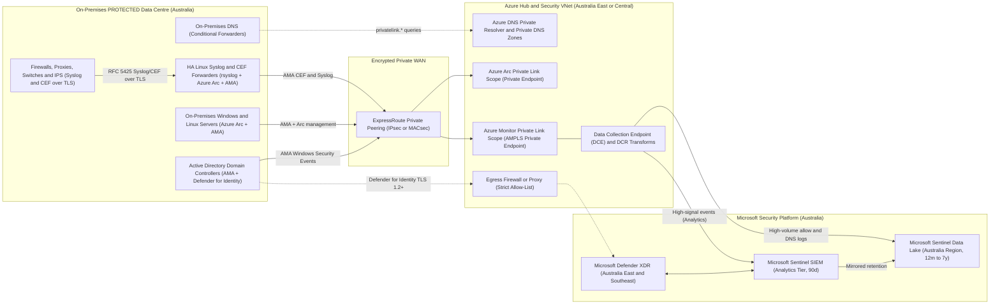

# Reference Architecture: Hybrid and On-Premises Log Sources at PROTECTED

This reference architecture describes how an Australian PROTECTED organisation collects security telemetry from on-premises Active Directory domain controllers, servers, firewalls and network appliances into Microsoft Sentinel, the Microsoft Sentinel data lake and Microsoft Defender XDR in an Australian Azure region using Azure Arc, Azure Monitor Agent (AMA) and Azure Private Link.

> **Disclaimer:** This is an independent community reference architecture. It is not produced, endorsed or supported by the Australian Signals Directorate (ASD), the Australian Cyber Security Centre (ACSC) or Microsoft. Validate every design against your agency's security risk assessment, gateway architecture, current ISM release and IRAP assessor.

## Architecture diagram



## Narrative

### 1. Azure Arc and Azure Monitor Agent (AMA)

On-premises Windows and Linux servers connect to Azure through [Azure Arc-enabled servers](https://learn.microsoft.com/en-us/azure/azure-arc/servers/overview) and emit telemetry via the [Azure Monitor Agent (AMA)](https://learn.microsoft.com/en-us/azure/azure-monitor/agents/azure-monitor-agent-overview).

- **Managed Identity authentication:** Azure Arc issues a Microsoft Entra Managed Identity to each onboarded on-premises host, allowing AMA to authenticate without distributing shared Log Analytics workspace keys.
- **Granular collection via DCRs:** Data Collection Rules (DCRs) define the exact Windows Event Log XPath filters, Syslog facilities and KQL ingestion-time transformations centrally in Azure, eliminating noisy events before they consume network bandwidth or SIEM ingestion capacity (`ISM-1959`).
- **Regional placement:** Azure Arc server resources, DCEs, DCRs, the Log Analytics workspace and the Sentinel data lake are all deployed in the same Australian Azure region (Australia East or Australia Central).

### 2. Syslog and CEF log forwarders for firewalls and network devices

Network appliances (border firewalls, web proxies, VPN concentrators, switches and intrusion prevention systems) cannot install AMA directly. Instead, they forward logs to a hardened, high-availability pair of Linux log collectors in the on-premises management zone ([Collect CEF logs via AMA](https://learn.microsoft.com/en-us/azure/sentinel/connect-common-event-format), [Collect Syslog via AMA](https://learn.microsoft.com/en-us/azure/sentinel/connect-syslog)):

- **Encrypted transport from appliance to forwarder (`ISM-1984`):** Configure appliances to send Syslog and CEF over TLS 1.2+ (RFC 5425, TCP 6514) rather than cleartext UDP 514. Where a legacy device does not support Syslog over TLS, isolate it on a dedicated management VLAN and terminate it on a local forwarder in the same security zone (`ISM-0529`, `ISM-1181`).
- **High availability and disk buffering:** Place two or more Linux forwarders (`rsyslog` or `syslog-ng`) behind an internal load balancer with local disk-assisted queues so logs buffer safely during WAN maintenance or rolling operating system patches (`ISM-1143`).
- **Tiered routing via DCRs:** Use DCR transformations to route firewall deny, IPS alert and admin audit events into the `CommonSecurityLog` Analytics table (for real-time detection), while sending high-volume firewall allow and proxy traffic directly to the Microsoft Sentinel data lake for 12-month searchable retention (`ISM-1988`, [ADR-0002](../adr/0002-retention-analytics-tier-and-data-lake.md)).

### 3. Active Directory Domain Controllers in Australia

On-premises Active Directory Domain Controllers are Tier 0 assets requiring layered telemetry:

- **Windows Security Events via AMA:** Onboard Domain Controllers (or deploy Windows Event Forwarding from Domain Controllers to a hardened Tier 0 Event Collector running Azure Arc and AMA if direct Arc agents on Domain Controllers are restricted by agency policy) to capture authentication, Kerberos, account management, group policy and directory service events (`ISM-1986`).
- **Microsoft Defender for Identity:** Deploy the Defender for Identity sensor on Domain Controllers to detect identity threats (such as Kerberoasting, DCSync and pass-the-ticket) directly in the unified Microsoft Defender portal ([ADR-0003](../adr/0003-defender-xdr-integration-and-unified-soc-platform.md)).
- **Authoritative time source (`ISM-0988`):** Ensure the PDC Emulator and Linux forwarders synchronise to an authoritative Australian NTP source so timestamps correlate accurately across on-premises and cloud logs.

### 4. Private Link, DNS and network isolation

Network isolation ensures monitoring telemetry traverses private paths and respects PROTECTED gateway boundaries (`ISM-1181`, `ISM-1984`, `ISM-2068`):

- **Private WAN transport:** Connect the on-premises PROTECTED environment to the Azure security hub VNet over **ExpressRoute Private Peering** with ASD-approved link encryption (MACsec on ExpressRoute Direct or IPsec tunnel over ExpressRoute), or an ASD-approved IPsec VPN gateway.
- **Azure Monitor Private Link Scope (AMPLS):** Bind the primary Log Analytics workspace and Data Collection Endpoints to an AMPLS with Private Endpoints inside the Azure hub VNet ([Design your Azure Monitor Private Link configuration](https://learn.microsoft.com/en-us/azure/azure-monitor/logs/private-link-design), [Configure Azure Monitor Private Link](https://learn.microsoft.com/en-us/azure/azure-monitor/logs/private-link-configure)).
- **Azure Arc Private Link Scope:** Bind Arc-enabled servers to an Azure Arc Private Link Scope so Arc control-plane heartbeats and extension downloads stay off the public internet.
- **Private DNS forwarding:** Configure on-premises DNS conditional forwarders pointing to an Azure DNS Private Resolver in the hub VNet for `privatelink.monitor.azure.com`, `privatelink.ods.opinsights.azure.com`, `privatelink.oms.opinsights.azure.com`, `privatelink.agentsvc.azure-automation.net`, `privatelink.his.arc.azure.com` and `privatelink.guestconfiguration.azure.com`.
- **Gateway exception for SaaS sensors:** Note that Microsoft Defender for Identity and Microsoft Defender for Endpoint sensors connect to Defender XDR cloud endpoints over TLS 1.2+ rather than through AMPLS. Route these connections through an inspected, strictly allow-listed egress proxy or gateway (`ISM-2068`) and document the endpoints in network documentation (`ISM-0518`).

### 5. Forwarder health monitoring

Monitor collector availability continuously to detect stalled rsyslog daemons, expired TLS certificates or ExpressRoute outages:

```kql
// Alert if any on-premises Syslog or CEF forwarder stops sending heartbeats for more than 15 minutes
Heartbeat
| where TimeGenerated > ago(1h)
| where Computer has_any ("syslog", "cef", "fwd")
| summarize LastHeartbeat = max(TimeGenerated) by Computer, Category
| where LastHeartbeat < ago(15m)
| sort by LastHeartbeat asc
```

## Related references

- [Service availability, Australian regions and IRAP status](../docs/service-availability-and-irap.md)
- [Reference architecture: single agency at PROTECTED](single-agency-protected.md)
- [ADR-0002: Retention, analytics tier and Sentinel data lake](../adr/0002-retention-analytics-tier-and-data-lake.md)
- [Azure Arc-enabled servers overview](https://learn.microsoft.com/en-us/azure/azure-arc/servers/overview)
- [Azure Monitor Agent overview](https://learn.microsoft.com/en-us/azure/azure-monitor/agents/azure-monitor-agent-overview)
- [Collect Common Event Format (CEF) logs with AMA](https://learn.microsoft.com/en-us/azure/sentinel/connect-common-event-format)
- [Collect Syslog data with AMA](https://learn.microsoft.com/en-us/azure/sentinel/connect-syslog)
- [Design your Azure Monitor Private Link configuration](https://learn.microsoft.com/en-us/azure/azure-monitor/logs/private-link-design)
- [ISM Guidelines for System Monitoring](https://www.cyber.gov.au/resources-business-and-government/essential-cyber-security/ism/cyber-security-guidelines/guidelines-system-monitoring)
- [ISM Guidelines for Networking](https://www.cyber.gov.au/resources-business-and-government/essential-cyber-security/ism/cyber-security-guidelines/guidelines-networking)
