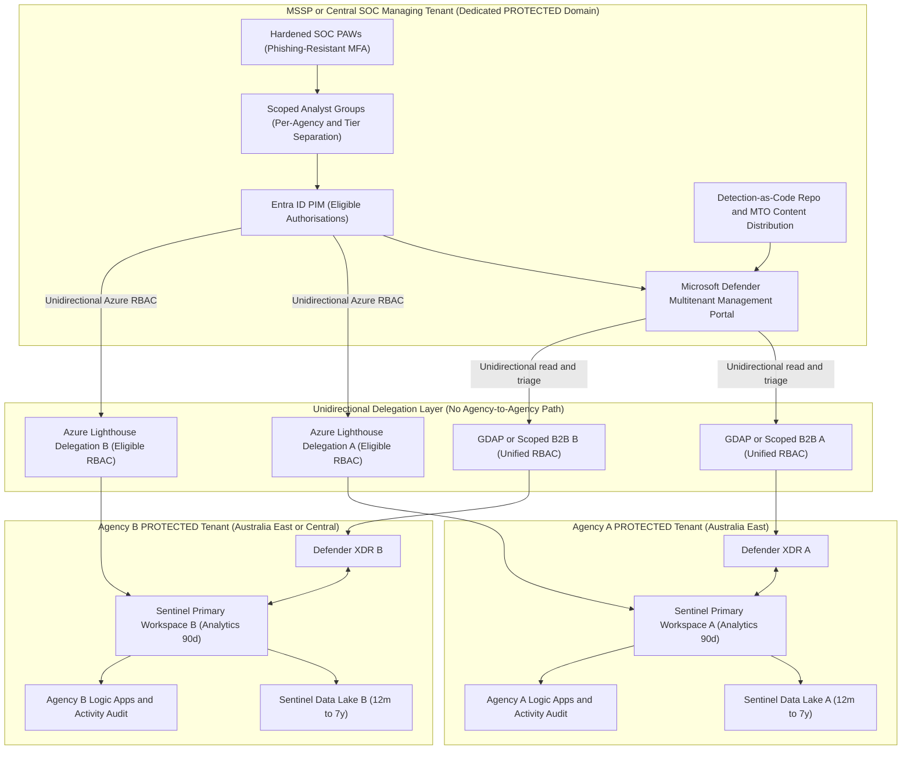

# Reference Architecture: Multi-Tenant and MSSP at PROTECTED

This reference architecture describes how a Managed Security Service Provider (MSSP) or shared government SOC operates Microsoft Sentinel, the Microsoft Sentinel data lake and Microsoft Defender XDR across multiple Australian PROTECTED agency tenants without co-mingling agency data.

> **Disclaimer:** This is an independent community reference architecture. It is not produced, endorsed or supported by the Australian Signals Directorate (ASD), the Australian Cyber Security Centre (ACSC) or Microsoft. Validate every design against your organisation's security risk assessment, contractual obligations, current ISM release and IRAP assessor.

## Architecture diagram

## Narrative

### 1. Dedicated managing tenant and access model

An MSSP or shared government SOC monitoring PROTECTED tenants operates a dedicated managing Microsoft Entra ID tenant separated from its corporate commercial tenant ([ADR-0001](../adr/0001-workspace-and-tenant-design-at-protected.md)).

- **Hardened operator workstations:** Analysts operate exclusively from dedicated Privileged Access Workstations (PAWs) enforcing device compliance, application control and phishing-resistant MFA (`ISM-1380`, `ISM-1688`).
- **Role and customer scoping:** Instead of granting one broad group standing access to every agency, the managing tenant defines security groups segmented by analyst tier (Tier 1 triage, Tier 2 investigation, Detection Engineering) and, where required by agency risk tolerance or clearance caveats, by individual agency cohort.
- **Just-in-time elevation:** Elevated roles are assigned as **eligible authorisations** rather than permanent active roles, requiring Entra ID Privileged Identity Management (PIM) activation with ticket justification and time-bound expiry.

### 2. Azure Lighthouse and Defender multitenant management

Cross-tenant visibility uses two complementary Microsoft capabilities without replicating agency logs into a central MSSP workspace ([Manage multiple tenants in Microsoft Sentinel as an MSSP](https://learn.microsoft.com/en-us/azure/sentinel/multiple-tenants-service-providers)):

- **Azure Lighthouse:** Agencies deploy a scoped Lighthouse registration template granting unidirectional Azure RBAC permissions to designated managing-tenant security groups over the Sentinel resource group only ([Azure Lighthouse overview](https://learn.microsoft.com/en-us/azure/lighthouse/overview)). The managing tenant can query workspaces, manage incidents and run authorised playbooks; the customer tenant has zero access back into the managing tenant or into other customers.
- **Microsoft Defender multitenant management (MTO):** Connects onboarded agency Defender portals into one aggregated incident queue and cross-tenant Advanced Hunting pane ([Microsoft Defender multitenant management overview](https://learn.microsoft.com/en-us/defender-xdr/mto-overview), [Set up multitenant management](https://learn.microsoft.com/en-us/defender-xdr/mto-requirements)). Content distribution profiles push versioned analytics rules, automation rules, workbooks and parsers consistently across target agency cohorts.

### 3. Segregation of duties and data boundaries

Strict separation between the MSSP and each agency underpins IRAP assurance and contractual governance:

- **Agency data ownership:** Every agency owns its Microsoft Entra tenant, Azure subscription, Log Analytics workspace, Microsoft Sentinel data lake and Defender XDR store in an Australian Azure region (`ISM-1451`, `ISM-1573`). Raw PROTECTED logs never leave the agency's tenant.
- **Role separation:** MSSP analysts hold least-privilege operational roles (such as `Microsoft Sentinel Responder`, `Microsoft Sentinel Reader` or scoped Defender Unified RBAC roles) and cannot delete workspaces, weaken retention policies, modify Entra Global Administrator roles or alter Azure Resource Locks (`ISM-1815`, `ISM-1985`).
- **Unilateral agency revocation:** Each agency retains full control of its Azure Lighthouse registration assignments and GDAP/B2B relationships, enabling immediate revocation during an incident or contract exit (`ISM-1804`).
- **Independent audit trail:** All MSSP actions executed through Azure Lighthouse and Defender multitenant management are logged in the agency's own Azure Activity Log, Entra ID Audit Log and Microsoft Purview audit log, preserving an independent record of provider activity.

### 4. Detection engineering and SOAR boundaries

- **Versioned detection content:** Baseline detection packs live in an MSSP-managed Git repository and are promoted through testing workspaces before distribution to agency tenants via Defender multitenant content distribution or agency-approved CI/CD pipelines.
- **Playbook isolation:** SOAR Logic Apps execute inside each agency's own subscription using that agency's Managed Identities and private endpoints. Containment actions (such as isolating a domain controller or disabling a senior executive account) use agency-approved playbooks and explicit escalation gates.

## Risks and mitigations

Multi-tenant SOC operation introduces shared-service risks that must be explicitly assessed and treated for PROTECTED accreditation:

| Risk | Description | Potential impact | Mitigations | Relevant ISM controls |
| :--- | :--- | :--- | :--- | :--- |
| Managing tenant or PAW compromise | An attacker compromises an MSSP analyst identity or workstation and pivots into multiple PROTECTED agency tenants via Lighthouse or Defender MTO. | Multi-agency confidentiality breach or coordinated tampering with detections across agencies. | Dedicated PROTECTED managing tenant; hardened PAWs; phishing-resistant MFA; PIM eligible authorisations with short durations; strict per-tier and per-agency group segmentation; independent monitoring of the managing tenant itself. | `ISM-1380`, `ISM-1688`, `ISM-1985`, `ISM-1395` |
| Cross-agency data spillage | Sensitive PROTECTED log excerpts, hostnames or incident details from Agency A leak into Agency B tickets, shared MSSP ITSM tools, shared workbooks or analyst clipboard exports. | Security incident (`ISM-0133` data spill) breaching agency confidentiality and PSPF obligations. | Keep all raw telemetry inside each agency tenant; pass only incident IDs, severities and portal links into MSSP ticketing systems (never raw log payloads); enforce PAW session and download restrictions; avoid cross-agency result exports. | `ISM-0133`, `ISM-1451`, `ISM-1985` |
| Over-privileged delegation | Granting broad subscription `Owner`, `Contributor` or Entra `Global Administrator` roles to the MSSP erodes segregation of duties. | Unauthorised modification of agency infrastructure, weakening of logging controls or inability to attribute changes. | Scope Azure Lighthouse to the Sentinel resource group only; assign `Microsoft Sentinel Responder` / `Reader` rather than `Owner`; retain `CanNotDelete` resource locks and Azure Policy governance solely under agency administrators. | `ISM-1815`, `ISM-1985`, `ISM-1571` |
| Network bridging between MSSP and agency VNets | Establishing direct VPN or VNet peering between the MSSP corporate network and multiple agency PROTECTED networks creates lateral network paths. | Violates provider network segregation and expands accreditation boundaries across agencies. | Operate SOC access strictly through Azure Lighthouse and the Microsoft Defender portal over HTTPS without direct VNet peering between MSSP and agency environments. | `ISM-1577`, `ISM-1181` |
| Offboarding and audit retention failure | Agency exits MSSP contract without cleanly revoking delegated access or retaining historical SOC investigation records. | Residual unauthorised access or loss of incident register evidence. | Document and test an offboarding checklist removing Lighthouse delegations and GDAP/B2B access; store incident comments, audit logs and Sentinel data lake holdings exclusively inside the agency's own tenant; enforce contractual break clauses. | `ISM-1573`, `ISM-1736`, `ISM-1804`, `ISM-0125` |
| Detection drift and noisy cross-tenant pushes | Pushing untested analytics rules across all agency tenants causes alert storms or breaks agency-specific exclusions. | Alert fatigue, missed genuine incidents (`ISM-1228`) or unintended SOAR execution. | Stage content updates in a dedicated MSSP validation tenant; separate baseline rules from agency-specific tuning watchlists; require change review before updating Defender MTO distribution profiles. | `ISM-0580`, `ISM-1228`, `ISM-1819` |

## Related references

- [Service availability, Australian regions and IRAP status](../docs/service-availability-and-irap.md)
- [ADR-0001: Workspace and tenant design at PROTECTED](../adr/0001-workspace-and-tenant-design-at-protected.md)
- [ADR-0003: Defender XDR integration and unified SOC platform](../adr/0003-defender-xdr-integration-and-unified-soc-platform.md)
- [Manage multiple tenants in Microsoft Sentinel as an MSSP](https://learn.microsoft.com/en-us/azure/sentinel/multiple-tenants-service-providers)
- [Extend Microsoft Sentinel across workspaces and tenants](https://learn.microsoft.com/en-us/azure/sentinel/extend-sentinel-across-workspaces-tenants)
- [Azure Lighthouse overview](https://learn.microsoft.com/en-us/azure/lighthouse/overview)
- [Microsoft Defender multitenant management overview](https://learn.microsoft.com/en-us/defender-xdr/mto-overview)
- [ISM Guidelines for Procurement and Outsourcing](https://www.cyber.gov.au/resources-business-and-government/essential-cyber-security/ism/cyber-security-guidelines/guidelines-procurement-and-outsourcing)
- [ISM Guidelines for Networking](https://www.cyber.gov.au/resources-business-and-government/essential-cyber-security/ism/cyber-security-guidelines/guidelines-networking)
- [ISM Guidelines for Cyber Security Incidents](https://www.cyber.gov.au/resources-business-and-government/essential-cyber-security/ism/cyber-security-guidelines/guidelines-cyber-security-incidents)
