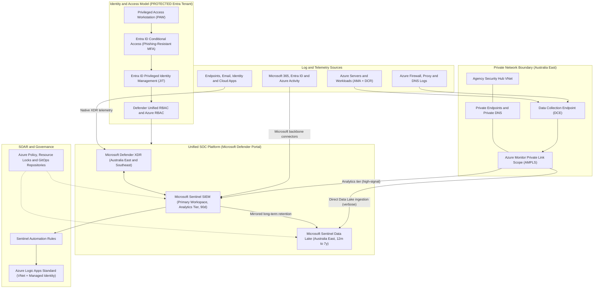

# Reference Architecture: Single Agency at PROTECTED

This reference architecture describes a single Australian Government agency deploying Microsoft Sentinel, the Microsoft Sentinel data lake and Microsoft Defender XDR in a dedicated PROTECTED Microsoft Entra ID tenant hosted in **Australia East** (with notes where an agency selects **Australia Central**).

> **Disclaimer:** This is an independent community reference architecture. It is not produced, endorsed or supported by the Australian Signals Directorate (ASD), the Australian Cyber Security Centre (ACSC) or Microsoft. Validate every component against your agency's security risk assessment, current ISM release and IRAP assessor.

## Architecture diagram



## Narrative

### 1. Identity and access model

The agency operates a dedicated Microsoft Entra ID tenant for its PROTECTED security domain, separated from OFFICIAL corporate tenants ([ADR-0001](../adr/0001-workspace-and-tenant-design-at-protected.md)).

- **Privileged Access Workstations (PAWs):** SOC analysts, detection engineers and Sentinel administrators access the Microsoft Defender portal and Azure control plane exclusively from hardened PAWs separated from unprivileged browsing and email environments (`ISM-1380`, `ISM-1688`).
- **Conditional Access and PIM:** Entra ID Conditional Access enforces FIDO2 or certificate-based phishing-resistant MFA, compliant PAW device state and approved Australian egress IP ranges. Standing privileged access is prohibited; engineers activate scoped roles through Entra ID Privileged Identity Management (PIM) with justification and approval workflows.
- **Role separation:** Permissions are split using [Microsoft Defender XDR unified RBAC](https://learn.microsoft.com/en-us/azure/sentinel/transition-unified-rbac) and [Azure RBAC for Microsoft Sentinel](https://learn.microsoft.com/en-us/azure/sentinel/roles) so Tier 1 triage analysts cannot modify analytics rules, retention settings or playbooks, while detection engineers promote changes through source control rather than direct production edits.

### 2. Network boundary and private connectivity

The Log Analytics workspace and Data Collection Endpoints (DCEs) sit inside a dedicated security subscription in **Australia East** and are bound to an [Azure Monitor Private Link Scope (AMPLS)](https://learn.microsoft.com/en-us/azure/azure-monitor/logs/private-link-design).

- **Private ingestion and query paths:** Azure virtual machines and security appliances forward telemetry via Azure Monitor Agent (AMA) and Data Collection Rules (DCRs) to Private Link-backed DCEs. Private DNS zones (`privatelink.monitor.azure.com`, `privatelink.oms.opinsights.azure.com`, `privatelink.ods.opinsights.azure.com`, `privatelink.agentsvc.azure-automation.net`) keep ingestion and query traffic on the Microsoft backbone.
- **Cloud-to-cloud connectors:** Service-to-service connectors (Microsoft Entra ID, Microsoft 365, Azure Activity, Microsoft Defender for Cloud) traverse Microsoft's internal cloud backbone outside the customer VNet and continue operating when public ingestion is restricted for agent traffic ([Configure Azure Monitor Private Link](https://learn.microsoft.com/en-us/azure/azure-monitor/logs/private-link-configure)).
- **Canberra region option:** Agencies requiring Log Analytics storage in **Australia Central** deploy the workspace and Sentinel data lake in Australia Central, noting that Microsoft Defender XDR Australian storage remains in Australia East and Australia Southeast ([Service availability, Australian regions and IRAP status](../docs/service-availability-and-irap.md)).

### 3. Log sources and ingestion routing

Logs are categorised before ingestion to align detection coverage with cost discipline ([ADR-0002](../adr/0002-retention-analytics-tier-and-data-lake.md)):

- **High-signal sources routed to Analytics tier:** Entra ID sign-in and audit logs, Azure Activity, Microsoft 365 audit logs, Defender XDR alerts and core security events, Windows and Linux security events (filtered via DCRs to remove noise), and firewall/IPS deny or threat alerts.
- **High-volume verbose sources routed directly to Sentinel data lake:** Firewall allow logs, DNS query logs, web proxy logs and VNet flow logs are sent directly to the data lake tier via [direct ingestion](https://learn.microsoft.com/en-us/azure/sentinel/datalake/sentinel-lake-log-ingestion-guidance), with summary rules promoting anomalies to Analytics when required.
- **Time synchronisation and normalisation:** All log sources synchronise to authoritative Australian NTP servers (`ISM-0988`), and DCR transformations normalise fields into structured schemas aligned with the Advanced Security Information Model (ASIM) (`ISM-1959`).

### 4. Microsoft Sentinel, Sentinel data lake and Defender XDR

Following [ADR-0003](../adr/0003-defender-xdr-integration-and-unified-soc-platform.md), the primary Microsoft Sentinel workspace is onboarded to the **Microsoft Defender portal** well ahead of the **31 March 2027** retirement of Sentinel in the Azure portal ([Transition Your Microsoft Sentinel Environment to the Defender Portal](https://learn.microsoft.com/en-us/azure/sentinel/move-to-defender)).

- **Unified detection and hunting:** Defender XDR handles endpoint, email, identity and cloud app telemetry natively with custom detections and automatic attack disruption. Sentinel runs scheduled and near-real-time (NRT) analytics rules across cloud, network and infrastructure logs, merging related alerts into one unified incident queue.
- **Tiered retention:** Analytics tables retain 90 days interactively (included with Sentinel) and mirror into the colocated [Microsoft Sentinel data lake](https://learn.microsoft.com/en-us/azure/sentinel/datalake/sentinel-lake-overview) for at least **365 days** searchable retention (`ISM-1988`), extending to **7 years (2,555 days)** for incident records and high-assurance audit classes where required by agency disposal authorities.
- **CMK and IRAP validation:** Where an agency's current IRAP authorisation does not yet include the Sentinel data lake or requires CMK across archived logs, Log Analytics long-term retention plus immutable Azure Storage (WORM) in Australia East or Australia Central serves as the interim archive pattern ([ADR-0002](../adr/0002-retention-analytics-tier-and-data-lake.md)).

### 5. SOAR and response automation

Automated triage and containment follow least-privilege engineering ([Automation rules and playbooks in the Defender portal](https://learn.microsoft.com/en-us/defender-xdr/siem-defender-automation)):

- **Automation rules** perform low-risk incident management (tagging, severity adjustment, owner assignment, invoking playbooks).
- **Azure Logic Apps (Standard plan)** run inside a dedicated subnet with VNet integration, private endpoints and Managed Identities (no stored API keys or long-lived client secrets) ([Azure Logic Apps for Microsoft Sentinel playbooks](https://learn.microsoft.com/en-us/azure/sentinel/automation/logic-apps-playbooks)).
- **Human-in-the-loop gates:** Read-only enrichment playbooks execute automatically; disruptive actions (disabling privileged accounts, isolating critical servers or blocking gateway prefixes) require analyst approval recorded in the incident audit trail.

### 6. Governance, resilience and ingestion monitoring

- **Detection-as-Code:** Analytics rules, hunting queries, DCRs and Logic Apps are stored in Git repositories and deployed via reviewed pull requests with automated validation.
- **Tamper resistance:** Azure Resource Locks (`CanNotDelete`) and Azure Policy prevent unauthorised workspace deletion or retention reductions below 365 days (`ISM-1815`).
- **Telemetry health check:** Scheduled monitoring detects silent log sources using KQL against the `Usage` and `Heartbeat` tables:

```kql
// Identify workspaces or log tables with zero billable ingestion in the past 24 hours
Usage
| where TimeGenerated > ago(7d)
| summarize LastSeen = max(TimeGenerated), RecentMB = sumif(Quantity, TimeGenerated > ago(24h)) by DataType
| where RecentMB == 0
| sort by LastSeen asc
```

## ISM control mapping

Controls are referenced from the [Information Security Manual (ISM)](https://www.cyber.gov.au/resources-business-and-government/essential-cyber-security/ism) (September 2026 release). Always verify applicability against the latest ISM release.

| Architecture element | ISM control | Requirement summary | Implementation in this architecture |
| :--- | :--- | :--- | :--- |
| Security monitoring governance | `ISM-0580` | Security monitoring policy developed, implemented and maintained | Documented logging scope, DCR rules, alert SLAs and retention matrix backed by ADR-0002 |
| Primary Sentinel workspace | `ISM-1405` | Centralised event logging facility implemented | Single primary Log Analytics workspace with Microsoft Sentinel in Australia East (or Australia Central) |
| AMA, DCRs and native connectors | `ISM-1983` | Event logs sent to centralised logging facility as soon as possible | Real-time streaming via AMA over private endpoints and native cloud connectors |
| AMPLS and TLS 1.2+ transport | `ISM-1984` | Event logs encrypted in transit using ASD-approved cryptography | TLS 1.2/1.3 over Private Link (AMPLS) and Microsoft backbone connectors |
| Unified RBAC, PIM and Private Link | `ISM-1985` | Event logs protected from unauthorised access | Defender Unified RBAC, Azure RBAC least privilege, PIM JIT access and private query endpoints |
| Resource Locks and Policy | `ISM-1815` | Event logs protected from unauthorised modification and deletion | Append-only Log Analytics tables, `CanNotDelete` resource locks and Azure Policy enforcing minimum retention |
| NTP configuration | `ISM-0988` | Accurate and consistent time source used for event logging | Authoritative Australian NTP synchronisation across all Azure VMs, servers and network appliances |
| DCR transformations and ASIM | `ISM-1959` | Event logs captured and stored in a consistent, structured format | DCR KQL transforms and ASIM parsers normalising schemas prior to analytics |
| Unified Defender portal and Sentinel | `ISM-0120` | Cyber security personnel have sufficient tools for detection and incident identification | Unified SIEM and XDR console, Advanced Hunting, Workbooks and SOAR automation |
| Threat intelligence integration | `ISM-2116` | Cyber threat intelligence services used to support detection | Microsoft Sentinel Threat Intelligence connectors (including ASD CTIS STIX/TAXII where eligible) |
| Analytics rules and Defender XDR | `ISM-1986`, `ISM-1987`, `ISM-1228` | Timely analysis of server, security product and cyber security events | Scheduled and NRT Sentinel analytics rules paired with Defender XDR custom detections |
| Quarterly threat hunting | `ISM-2153` | Threat hunting conducted at least every three months | 90-day Analytics interactive window plus Sentinel data lake KQL and notebook hunting |
| Sentinel data lake / archive | `ISM-1988` | Event logs retained in a searchable manner for at least 12 months | 90 days Analytics mirrored to Sentinel data lake (or archive) for minimum 365 days searchable retention |
| PAWs and Conditional Access | `ISM-1380`, `ISM-1688` | Separate privileged and unprivileged operating environments | Dedicated PAWs with phishing-resistant MFA required for all Defender portal and Azure admin access |
| Hub VNet and AMPLS | `ISM-1181` | Networks segregated into multiple network zones by criticality | Dedicated security subscription and VNet isolating monitoring, DCEs and Logic Apps from general workloads |
| Encryption at rest | `ISM-1080`, `ISM-1769` | ASD-approved cryptography (AES-256) used to encrypt data at rest | AES-256 platform encryption across Log Analytics, Data Lake and Defender XDR (with CMK caveats documented) |
| Incident queue and SOAR | `ISM-0125`, `ISM-1819` | Cyber security incident register maintained and response plan executed | Unified Defender portal incident queue, audit history and approved Logic Apps playbooks |

## Related references

- [Service availability, Australian regions and IRAP status](../docs/service-availability-and-irap.md)
- [ADR-0001: Workspace and tenant design at PROTECTED](../adr/0001-workspace-and-tenant-design-at-protected.md)
- [ADR-0002: Retention, analytics tier and Sentinel data lake](../adr/0002-retention-analytics-tier-and-data-lake.md)
- [ADR-0003: Defender XDR integration and unified SOC platform](../adr/0003-defender-xdr-integration-and-unified-soc-platform.md)
- [ISM Guidelines for System Monitoring](https://www.cyber.gov.au/resources-business-and-government/essential-cyber-security/ism/cyber-security-guidelines/guidelines-system-monitoring)
- [ISM Guidelines for System Management](https://www.cyber.gov.au/resources-business-and-government/essential-cyber-security/ism/cyber-security-guidelines/guidelines-system-management)
- [ISM Guidelines for Networking](https://www.cyber.gov.au/resources-business-and-government/essential-cyber-security/ism/cyber-security-guidelines/guidelines-networking)
- [ISM Guidelines for Cyber Security Incidents](https://www.cyber.gov.au/resources-business-and-government/essential-cyber-security/ism/cyber-security-guidelines/guidelines-cyber-security-incidents)
